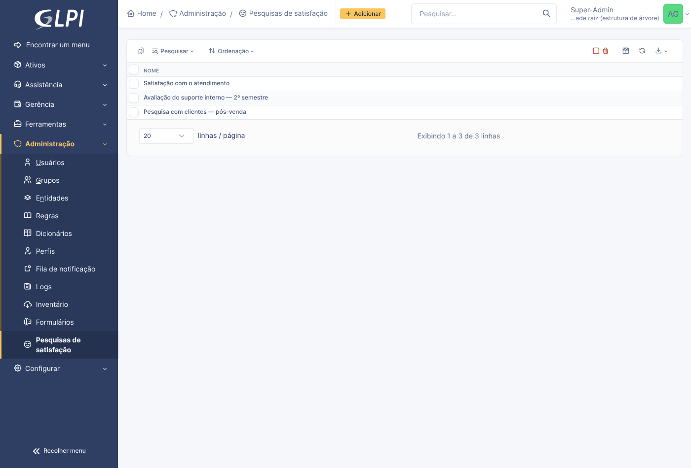
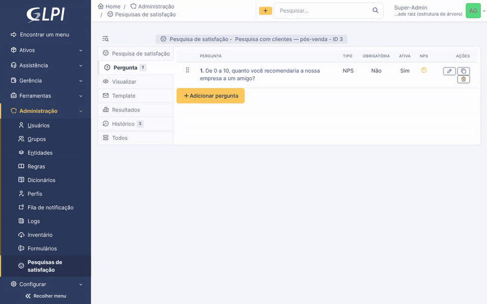
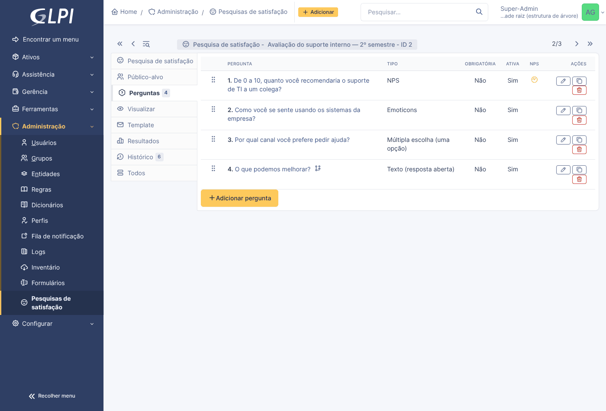
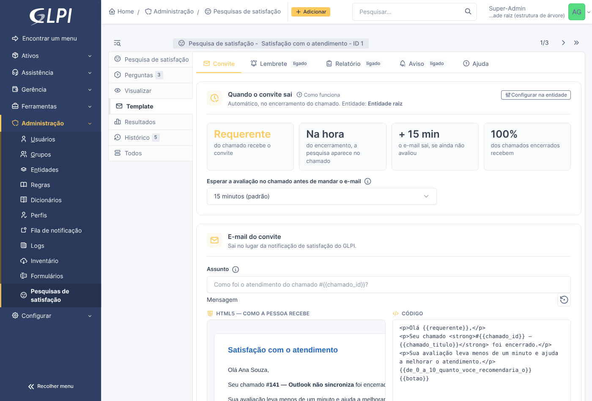
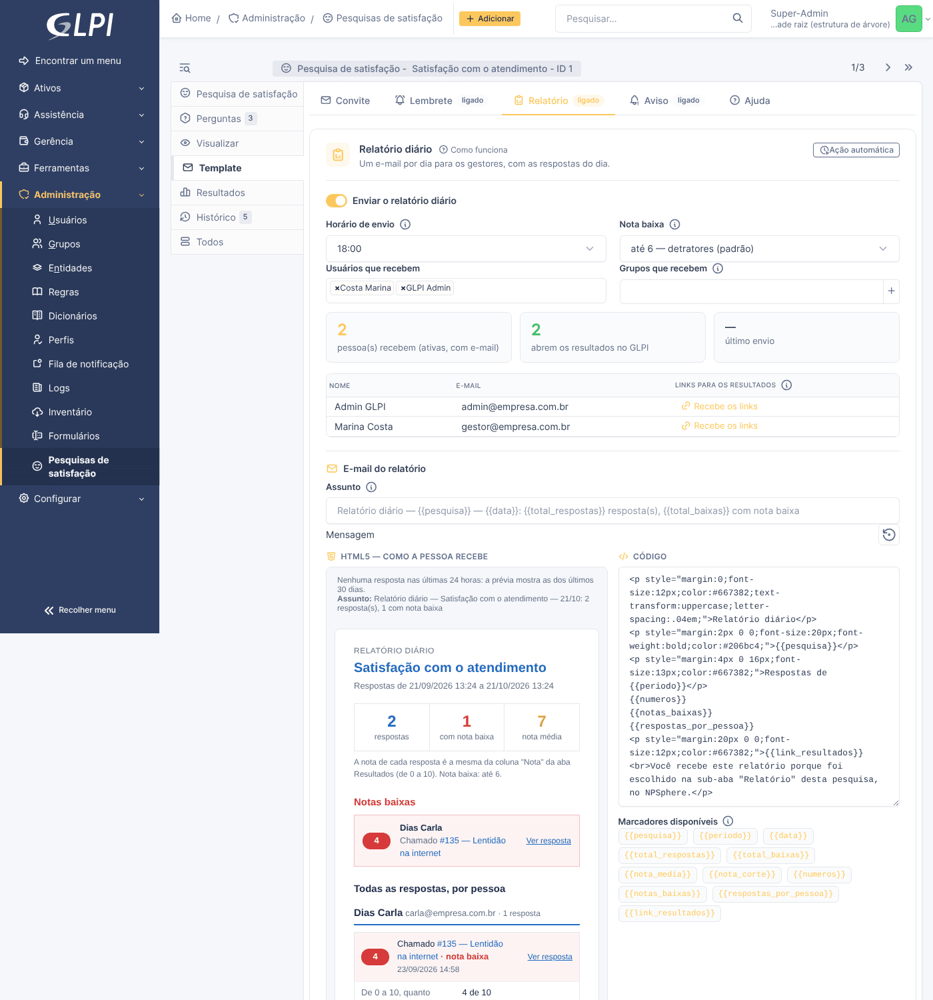
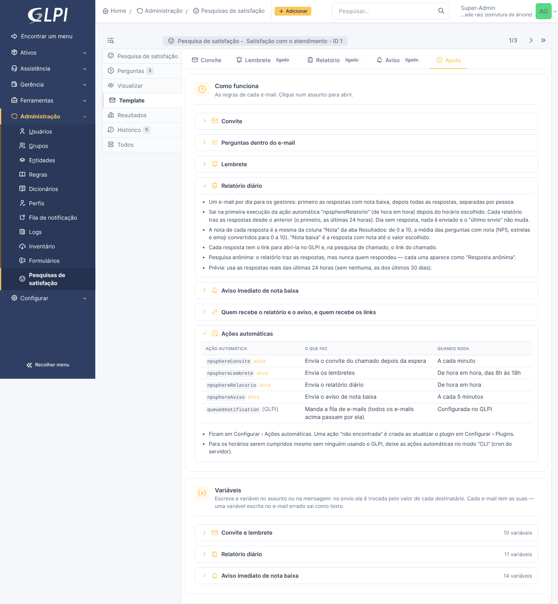
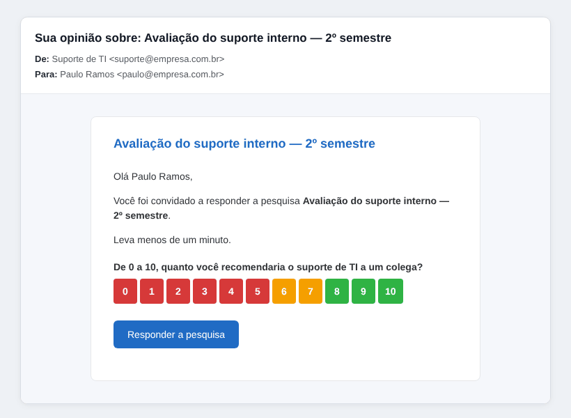
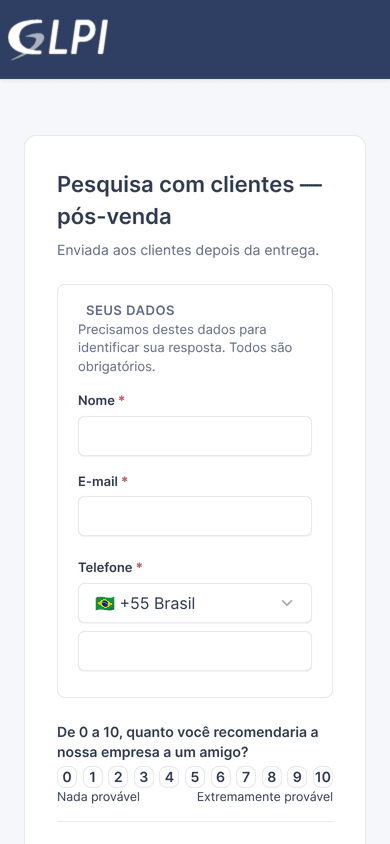
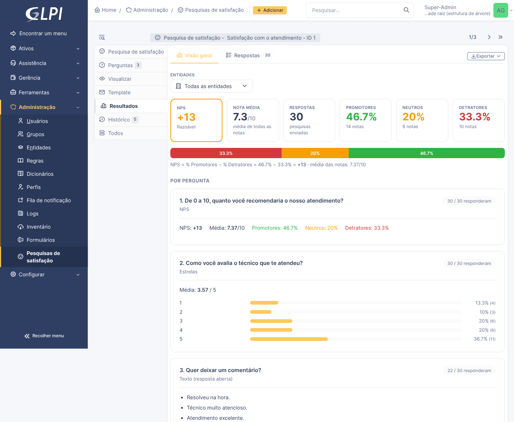
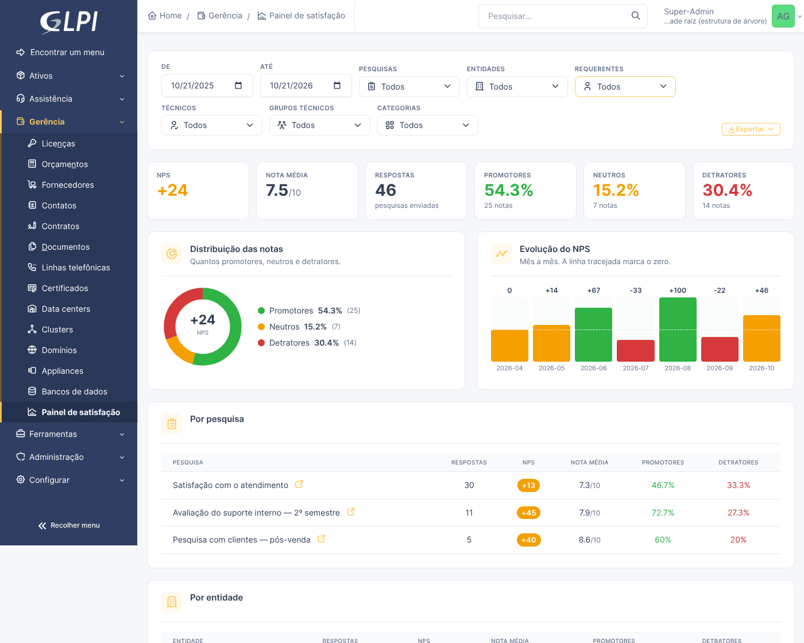

# NPSphere — Pesquisas de satisfação e NPS para o GLPI 11

   

O NPSphere é um plugin do **GLPI 11** para criar, enviar e medir pesquisas de satisfação: **NPS**, estrelas, emoji e outras perguntas. Ele funciona em três cenários:

- **pesquisas de chamado**, no lugar da pesquisa de satisfação nativa do GLPI;
- **pesquisas internas**, para usuários do GLPI;
- **pesquisas externas**, para quem não tem login.

A pessoa responde **com um clique, direto do e-mail**. Os resultados ficam num painel consolidado, e os gestores recebem relatório diário e aviso de nota baixa.

<p align="center">
  
  <br><em>Do e-mail à resposta registrada: clica na nota, completa o resto e pronto.</em>
</p>

---

## Sumário

- [Funcionalidades](#funcionalidades)
- [Como usar](#como-usar)
  1. [Criar a pesquisa](#1-criar-a-pesquisa)
  2. [Adicionar as perguntas](#2-adicionar-as-perguntas)
  3. [Conferir como fica](#3-conferir-como-fica)
  4. [Definir quem responde](#4-definir-quem-responde)
  5. [Configurar os e-mails (aba Template)](#5-configurar-os-e-mails-aba-template)
  6. [A pessoa responde](#6-a-pessoa-responde)
  7. [Acompanhar os resultados](#7-acompanhar-os-resultados)
  8. [Duplicar uma pesquisa](#8-duplicar-uma-pesquisa)
- [Requisitos](#requisitos)
- [Instalação](#instalação)
- [Pesquisa vinculada a chamado](#pesquisa-vinculada-a-chamado)
- [Estrutura do projeto](#estrutura-do-projeto)
- [Roadmap](#roadmap)
- [Licença e autor](#licença)

---

## Funcionalidades

| | |
|---|---|
| **7 tipos de pergunta** | NPS (0–10), Emoticons (3 ou 5 níveis), Estrelas (3, 5 ou 10), Sim/Não, Escolha única, Múltiplas opções e Texto |
| **Regras condicionais** | Uma pergunta só aparece conforme a resposta de outra (ex.: "O que podemos melhorar?" só para nota até 6) |
| **3 tipos de pesquisa** | De chamado (no lugar da nativa do GLPI), interna (usuários do GLPI) e externa (sem login, por link ou lista de e-mails) |
| **Resposta com um clique** | A nota clicada no e-mail já é gravada, sem login, com um link pessoal e assinado |
| **Convite com espera** | No chamado, o e-mail só sai se o requerente não avaliar no próprio chamado (padrão 15 min) |
| **Lembrete automático** | Para quem não respondeu, com intervalo e máximo configuráveis |
| **Relatório diário** | Para os gestores, no horário escolhido: notas baixas primeiro, depois todas as respostas por pessoa |
| **Aviso de nota baixa** | E-mail alguns minutos depois de uma resposta com nota baixa |
| **Modelos editáveis** | Assunto e mensagem em HTML, com prévia ao vivo e variáveis |
| **Resultados e painel** | NPS, nota média, evolução mensal, recortes por pesquisa, entidade, requerente, técnico, grupo e categoria, exportação CSV e impressão |
| **Segurança** | Cada pessoa gerencia as pesquisas que criou; tokens de 256 bits; links assinados; CSRF no padrão do GLPI 11 |

---

## Como usar

### 1. Criar a pesquisa

Em **Administração › Pesquisas de satisfação**, clique em **Adicionar**. Dê um nome, escolha o **tipo** (interna, externa ou vinculada a chamado), o período e como ela será respondida.

<p align="center"></p>
<p align="center"></p>

### 2. Adicionar as perguntas

Na aba **Perguntas**, clique em **Adicionar pergunta**, escreva o texto e escolha o tipo. Arraste pelas alças (⠿) para mudar a ordem. Em **Exibição condicional** dá para mostrar a pergunta só para quem respondeu algo específico.

<p align="center"></p>
<p align="center"></p>

### 3. Conferir como fica

A aba **Visualizar** mostra a pesquisa exatamente como quem responde vai ver. Nada do que é respondido ali é gravado.

<p align="center"></p>

### 4. Definir quem responde

| Tipo | Onde configurar |
|---|---|
| **Interna** | Aba **Público-alvo**: entidades, perfis, grupos, usuários ou todos. Quem está no público vê a pesquisa em **Minhas pesquisas** e pode receber o convite por e-mail. |
| **Externa** | Aba **Template › Convite › Destinatários**: um a um ou por CSV (`email;nome`). Também há o **link público**, para divulgar onde quiser. |
| **Chamado** | Na **entidade** (Assistência › Pesquisa de satisfação), com "Pesquisa externa" apontando para o NPSphere (veja [abaixo](#pesquisa-vinculada-a-chamado)). |

### 5. Configurar os e-mails (aba Template)

A aba **Template** tem cinco sub-abas:

- **Convite**: o e-mail que leva a pesquisa.
- **Lembrete**: o e-mail para quem ainda não respondeu.
- **Relatório**: o resumo diário dos gestores.
- **Aviso**: o e-mail imediato de nota baixa.
- **Ajuda**: as regras de cada e-mail e a lista de variáveis.

Cada e-mail tem **prévia ao vivo**, editor de código e botão para voltar ao modelo padrão. A ajuda de cada campo fica no ícone **ⓘ**, e o link **Como funciona** abre a Ajuda no assunto certo.

<p align="center"></p>

<details>
<summary><strong>Ver as telas da aba Template</strong></summary>

**Convite** (pesquisa de chamado):
<p align="center"></p>

**Relatório diário**, com quem recebe, quem recebe os links e a prévia com respostas reais:
<p align="center"></p>

**Aviso de nota baixa**:
<p align="center"></p>

**Ajuda**, com "Como funciona" por assunto, a tabela das ações automáticas e as variáveis:
<p align="center"></p>

</details>

### 6. A pessoa responde

**Pelo e-mail**: o convite mostra a pergunta de nota com as opções para clicar. O clique já registra a resposta, sem login, e abre a pesquisa para completar o resto.

<p align="center"></p>

**No próprio chamado**: a pesquisa aparece dentro do chamado encerrado, para o requerente.

<p align="center"></p>

**No celular**: o link público funciona em qualquer tela.

<p align="center"></p>

### 7. Acompanhar os resultados

A aba **Resultados** de cada pesquisa traz:
- o NPS, a nota média e a distribuição;
- a lista de quem respondeu, com o detalhe de cada resposta;
- a exportação CSV e a impressão.

<p align="center"></p>

O **Painel de satisfação** (em **Gestão**) junta todas as pesquisas, com evolução mensal, comparação com o período anterior e recortes por pesquisa, entidade, requerente, técnico, grupo técnico e categoria. **Clicar numa linha** filtra o painel por ela.

<p align="center"></p>
<p align="center"></p>

### 8. Duplicar uma pesquisa

Na tela da pesquisa, o botão **Duplicar** cria uma cópia.

- **A cópia leva:** as perguntas (com as regras condicionais) e os modelos de e-mail.
- **A cópia não leva:** o público-alvo, as respostas e os envios.
- Ela nasce **inativa**: revise, defina quem responde e ative quando estiver pronta.

---

## Requisitos

- GLPI **11.x**
- PHP **8.1** ou superior
- E-mail de saída configurado no GLPI (Configurar › Notificações), para convites, lembretes, relatório e aviso
- Ações automáticas do GLPI rodando. Recomenda-se o modo **CLI**, pelo cron do servidor, para os horários serem cumpridos mesmo sem ninguém usando o GLPI.

---

## Instalação

A pasta do plugin precisa se chamar **`npsphere`**.

**Pelo Git:**
```bash
cd /caminho/do/glpi/marketplace      # ou /caminho/do/glpi/plugins
git clone https://github.com/MichaelRodriguesOficial/NPS-GLPi.git npsphere
```

**Pelo ZIP:** extraia o pacote `npsphere-X.Y.Z.zip` dentro de `marketplace/` (ou `plugins/`).

Depois:

1. Em **Configurar › Plugins**, clique em **Instalar** e depois em **Ativar** no NPSphere.
2. Em **Administração › Perfis**, dê os direitos aos perfis:
   - **Pesquisas de satisfação** (`plugin_npsphere_survey`): criar e gerenciar pesquisas;
   - **Painel de satisfação** (`plugin_npsphere_dashboard`): ver o painel consolidado;
   - **Minhas pesquisas** (`plugin_npsphere_answer`): responder pesquisas internas.
3. Confira em **Configurar › Ações automáticas** se estas estão ativas:

| Ação automática | O que faz | Frequência |
|---|---|---|
| `npsphereConvite` | Envia o convite do chamado depois da espera | A cada minuto |
| `npsphereLembrete` | Envia os lembretes | De hora em hora, das 8h às 18h |
| `npsphereRelatorio` | Envia o relatório diário | De hora em hora |
| `npsphereAviso` | Envia o aviso de nota baixa | A cada 5 minutos |
| `queuednotification` *(GLPI)* | Manda a fila de e-mails | Configurada no GLPI |

**Atualizar:** substitua os arquivos (ou `git pull`) e clique em **Atualizar** em Configurar › Plugins. As migrações do banco rodam sozinhas. A atualização foi testada a partir da 0.50.0.

---

## Pesquisa vinculada a chamado

1. Crie a pesquisa com o tipo **Vinculada a chamado** e ative-a.
2. Na entidade, em **Assistência › Pesquisa de satisfação**, escolha **Pesquisa externa** e use a URL mostrada pelo plugin na aba da pesquisa:
   ```
   https://SEU-GLPI/marketplace/npsphere/front/ticket.php?tickets_id=[TICKET_ID]&surveys_id=N
   ```
3. O atraso, a porcentagem de chamados e a duração da pesquisa continuam sendo os da entidade, no padrão do GLPI.

Ao encerrar o chamado, a pesquisa aparece no próprio chamado.
- O e-mail sai depois da espera configurada, e só se o requerente ainda não tiver avaliado.
- A notificação de satisfação nativa do GLPI é cancelada, então a pessoa não recebe dois e-mails.
- A nota também é gravada em `glpi_ticketsatisfactions`.

---

## Estrutura do projeto

```
npsphere/
├── setup.php           # registro do plugin, hooks, versão
├── hook.php            # instalação, migrações e desinstalação
├── src/                # classes (namespace GlpiPlugin\Npsphere)
│   └── QuestionType/   # um arquivo por tipo de pergunta
├── front/              # páginas (formulários, painel, resposta pública)
├── ajax/               # endpoints AJAX (prévias, envio, exportação…)
├── templates/          # Twig
├── public/             # CSS e JavaScript
├── locales/            # traduções (.pot)
├── vendor/             # autoload do Composer (sem dependências externas)
├── docs/               # status do projeto e imagens deste README
└── CHANGELOG.md        # histórico de versões
```

**Tabelas:**
- `glpi_plugin_npsphere_surveys`, `_questions`, `_answers`, `_answervalues`, `_targets`, `_completions`, `_invites`, `_deliveries`;
- além da gravação em `glpi_ticketsatisfactions`, que é do GLPI.

---

## Roadmap

| Fase | Status |
|---|---|
| 1–8. Fundação, perguntas, respostas, métricas, regras condicionais, pesquisa externa, interna e de chamado | ✅ |
| 9. Notificações e convites por e-mail | ✅ |
| 10. Painel consolidado | ✅ |
| 11. Acabamentos: exportação ODS/XLSX, exclusões no público-alvo, auditoria, limite de requisições, tradução | ⏳ |

O detalhamento está em [`docs/NPSPHERE-STATUS.md`](docs/NPSPHERE-STATUS.md), e o histórico de cada versão, em [`CHANGELOG.md`](CHANGELOG.md).

> As telas deste README são de um GLPI 11.0.11 de demonstração, com dados fictícios.

---

## Licença

Distribuído sob a **GNU General Public License v3.0 ou posterior**. Veja [`LICENSE`](LICENSE).

## Autor

**Michael Rodrigues** — [@MichaelRodriguesOficial](https://github.com/MichaelRodriguesOficial)
